# Journey Together Forever

Level together. Chapter by chapter.

A World of Warcraft addon for a group of friends who want to level from 1 to 60 together, without anyone running ahead
or falling behind. You create a **fellowship**, invite your Adventurers, and walk the road to 60 as a book of
**chapters**. Each chapter has a level floor, a level cap and the dungeons you clear as a group. When the chapter is
done, the next one opens for everyone.

Built for **WoW Forever**.

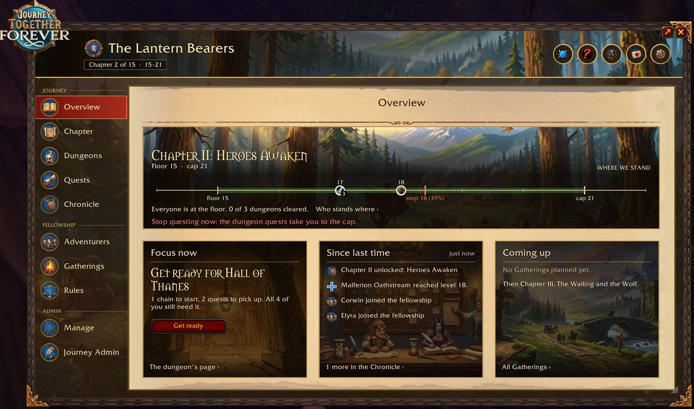

**At a glance**
- **Chapters, not a race**: the road to 60 in chapters, each with a floor, a cap and dungeons you clear together.
  Nobody runs ahead, and nobody is left behind.
- **No bookkeeping**: levels, clears from boss kills, quests and attunements are picked up as you play.
- **Ready for every dungeon**: each dungeon has a page with its quests in the order you act, the chains to start
  early, and who in the fellowship is ready.
- **Challenge modes**: Hardcore Fellowship, Shared lives, Lord of the Rings, Race to 60 and ten more, chosen when
  the fellowship is founded.
- **Your story, kept**: a Chronicle of every run, Firsts as a cabinet of medals, and Moments with who was there.
- **A group photo**: the whole fellowship in 3D on the whole screen, with poses and backdrops.
- **Your fellowship, your way**: your own journey, a rulebook anyone can propose changes to, Gatherings, a Guild
  Master tournament and posts to your Discord.

- [How it works](#how-it-works)
- [Features](#features):
  - [Play together](#play-together): [where you stand](#where-you-stand), [chapters and dungeons](#chapters-and-dungeons),
    [the dungeon pages](#the-dungeon-pages), [nobody left behind](#nobody-left-behind), [Adventurers](#the-adventurers), [quests](#quests-and-attunements),
    [Gatherings](#gatherings), [raids](#the-endgame-and-raids)
  - [Challenge modes](#challenge-modes)
  - [Lead the fellowship](#lead-the-fellowship): [creating a fellowship](#create-a-fellowship),
    [the journey](#shape-the-journey), [managing it](#manage-the-fellowship), [rules and votes](#the-rulebook-and-votes),
    [tournament](#guild-master-tournament)
  - [Memories](#memories): [Chronicle and Moments](#chronicle-moments-and-history), [group photo](#group-photo),
    [Discord](#discord)
  - [On your screen](#on-your-screen): [toasts and tracker](#toasts-the-tracker-and-the-picture-moment),
    [look and settings](#look-and-settings)
- [Commands](#commands) · [Playing at different times](#playing-at-different-times) · [Status](#status) ·
  [Install](#install) · [License and credits](#license-and-credits)

## How it works
- A **fellowship** is a group of characters of one faction, from any guild or none. It has two ranks: the **Leader**
  and the **Adventurers**. Joining is by invitation only.
- The **journey** is the road from level 1 to 60: a **Prologue** for levels 1-15, then chapters such as
  *Heroes Awaken, 15-21* or *The Wailing and the Wolf, 21-25*. The Forever journey, with every
  dungeon, has 15 chapters; the Classic journey, only Classic's own dungeons, has 12.
- Each chapter has a **floor** (the lowest level) and a **cap** (the highest). Its **dungeons open** when every
  Adventurer has reached the floor. The chapter is **complete** when its dungeons are cleared; a chapter without
  dungeons is complete when everyone has reached the cap. Then the next chapter opens for the whole fellowship.
- A dungeon is **cleared** for you once you were in the group for every boss that counts, in one run or over
  several. A boss kill counts when enough Adventurers of the fellowship are in the group (4 by default).
- Each dungeon in a chapter is **Mandatory**, a **Bridge** (it belongs to the next chapter but may be run now) or
  **Optional** (it never holds anyone back).
- Stay at or below the cap until the chapter is done. The rules say how strict that is, and fellowship runs may take
  you a level further.
- **Joining**: someone in a fellowship invites you by name, and the invitation shows on the **Join a fellowship** page
  and in your inbox. Choose your role and **Accept**. **Leaving** is a button on the Adventurers page; when the Leader
  leaves, the next Adventurer leads and the journey goes on for everyone else.

## Features

### Play together

#### Where you stand
The **Overview** answers "what now?" at a glance:
- **Where you stand**: one headline for the chapter ("Dungeons are open"), its three steps, your level on a line from
  the floor to the cap ("Ready, 3 levels to the cap") and one main button.
- **Play now**: the one best thing to do with whoever is online, with one button (Find group or Invite to group).
- **Where the Adventurers stand**: below the floor, ready, at the cap, over the cap, away; and the chapter's dungeons.
- **Room for the dungeon quests**: how far the chapter's dungeon quests (and the dungeons' mobs, once your fellowship
  has run them) will take you, and where to stop questing so they still fit under the cap: a red pin on your level
  bar, read like the game's XP bar ("level 26, 60% into it"). A quest's XP comes from the game itself. Two toasts warn
  you half a level before that point and at it.
- The **contents** of the whole journey (later chapters can stay hidden until reached), the next Gathering and the
  recent history.
- **Since you were last here**: what changed while you were away, who levelled, and where the fellowship stands now.

#### Chapters and dungeons
- A **stage track** for the chapter: Everyone at the floor, Run the dungeons, Milestones, Complete. While someone is
  below the floor, a waiting box says who, how far, and about how long at their pace.
- The **level track**: the chapter's floor and cap with every Adventurer on one line, also on the Adventurers page.
- Every dungeon as a row with its picture, role, levels and state ("4 of 7 bosses", "2 still need it"), with
  **Find group**, which invites the Adventurers online who still need it (a tank and a healer first). Point at a
  picture to see it large.
- The dungeons in a **suggested order**: the mandatory ones first, lowest levels first, then the bridges and optional
  ones. With several mandatory dungeons, the first one not cleared says **Recommended next**.
- A **scroll** on each row with the number of quests to pick up before you go. A click on the row opens
  [the dungeon's page](#the-dungeon-pages).
- **Clears are picked up from boss kills** (no clicking needed). A message with the dungeon's picture and who was in
  the group tells everyone the moment the last needed boss dies; Adventurers outside the group hear it when the group
  leaves the instance.
- A **clears table** (Adventurer by dungeon). The Leader can mark a clear or undo one; undoing a clear an earlier
  chapter needs reopens that chapter, and the question says so first.

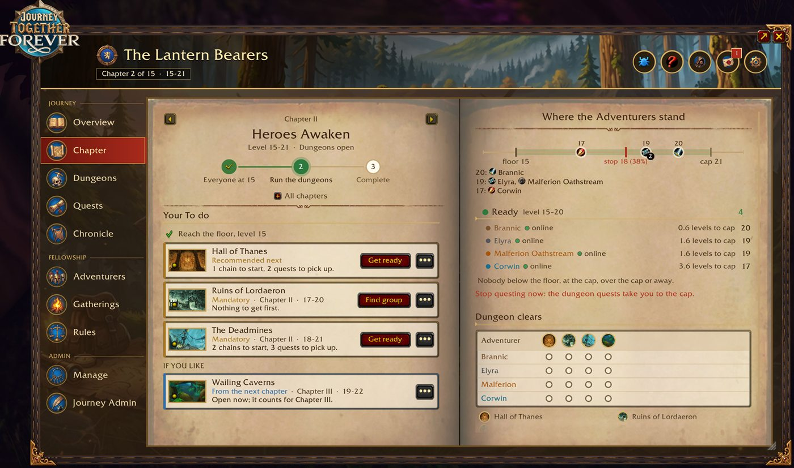

#### The dungeon pages
Every dungeon and raid has a page of its own. Open it from a dungeon row on the Chapter page, the Overview, Journey
Admin, the Dungeon quests list or a raid card; **‹ Back** returns to where you were.
- Its picture, a short story, its bosses with how many Adventurers were there, who cleared it, and how much room its
  quests and mobs give you.
- At the foot: **Find group**, a **Waypoint** to the entrance and shortcuts to other addons when you have them: the
  **Dungeon Journal** addon (loot, quests) and **Spoken** or **Lore Forever** (more of its story; Settings says which
  comes first). Nothing of theirs is copied into this addon. The Classic entrances are built in; where an Adventurer
  walks into a dungeon is learned for the whole fellowship, also for WoW Forever's new dungeons.
- **Who is ready**: a ring for each Adventurer fills as they pick up the dungeon's quests and turns gold when they are
  ready. Click someone to see their quests. **Remind** an Adventurer who is online and not ready, once a day.
- Its quests for your side, in the order you act: **1. Start early** (each step of the chain before a dungeon quest,
  with its level and where it starts), **2. Pick up before you go** and **3. Starts inside**. **Pin on map** sets a
  waypoint to where a quest starts.

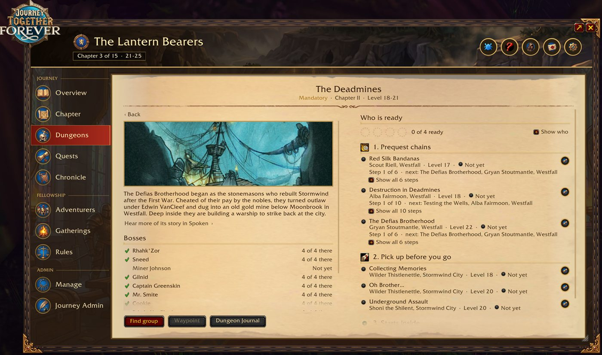

#### Nobody left behind
- **Help runs**: a group with someone below the floor counts as a fellowship run.
- **Catching up**: someone who joins far below the current floor does not hold the fellowship back; they count
  like everyone once they reach the floor.
- **You pull ahead**: a toast when you are two or more levels above an Adventurer, and a **cap warning** in chat
  before you reach the cap (at a share of the last level you choose).
- Going over the cap is written to the Chronicle.
- **Away**: anyone can mark themselves away for a break, and an Adventurer not seen for 14 days (a rule) counts as
  away, so nobody waits for them.
- **If the Leader is away** for the rule's number of days, the Adventurer who joined first takes over.
- **Friend of the fellowship**: someone who plays along now and then. A Friend fills a slot in a dungeon run but never
  counts for the floor, the votes, the firsts, the tournament or the challenges. Invite them as one, or become one
  yourself; back to Adventurer at or below the chapter's cap.

#### The Adventurers
- Every Adventurer with role, class, level, XP and rested XP, and a **presence mark** like the game's friends list:
  Online, AFK, Offline ("Seen 3 hours ago") or Away. A ring shows someone the game says is online whose addon does
  not answer.
- **3D heads**: yours always; another Adventurer's once they have been near you: in your group, your target or focus,
  under your mouse, or with their nameplate showing (the game only draws players it has seen). Before that, their
  class crest and when they were last near you.
- **Inspect**: their gear around the character in 3D, item level, XP, this chapter's dungeons, roles, Whisper and
  Invite to group. Someone who is not near you shows a card with their class, role, item level and their gear as a
  list in its quality colours.
- **Invite Adventurers**: everyone can invite; the name box fills in names as you type, like the game's mail: friends,
  Battle.net friends, guild members, your group and the people you played with lately.
  Someone without the addon? **Share it** gives you the addon's page to whisper them. The invitation reaches them
  as a toast with **Accept** and **Decline**.
- **Roles** and a secondary role, **I'm away**, and the fellowship's make-up (tanks, healers, damage).
- **Old addon**: everyone sees who runs an older version, and you get one reminder per session when it is you.
- **Your characters**: every character on your account with its fellowship, "as of" when you last played it.
  **Follow** another character's fellowship live while you play an alt (also one made today), and **take that
  character's place** in the fellowship with the same rank and roles.

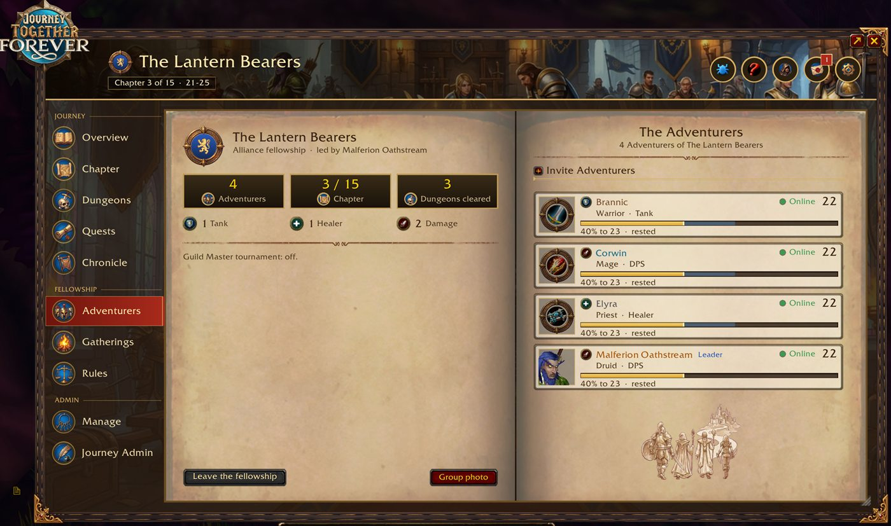

#### Quests and attunements
The **Quests** page has four tabs:
- **Dungeon quests**: the dungeons that open at your chapter, each with your ring, a scroll with the quests still to
  pick up or start, and a door where every quest starts inside. Every dungeon has its quest list, with each quest's
  level and where it starts (the quest giver and zone, an item, or inside). With Questie running, a quest whose start
  the addon does not know yet shows Questie's quest giver and place; nothing of Questie's is kept or sent. Where a
  quest starts is also learned when anyone in the fellowship picks it up, and a toast tells you when a dungeon's first
  quest opens to you. The right page lists your chapter's dungeons with how many Adventurers are ready ("2 of 4
  ready").
- **Shared quests**: quests you and other Adventurers have (**Together now**) and quests they have that you could
  pick up (**Pick up and join**), grouped by zone with the zone you are in first, with everyone's progress and what you can do: **Ask to group up**, Invite to group, or
  the game's **Share quest**.
- **Quest chains** learned as the fellowship plays, or all of them from the start with Questie installed.
- **Attunements and keys** up to 60 (Onyxia, Upper Blackrock Spire, Scholomance,
  Blackrock Depths, Stratholme, Dire Maul and more): a grid of who has done what, and each one's steps.

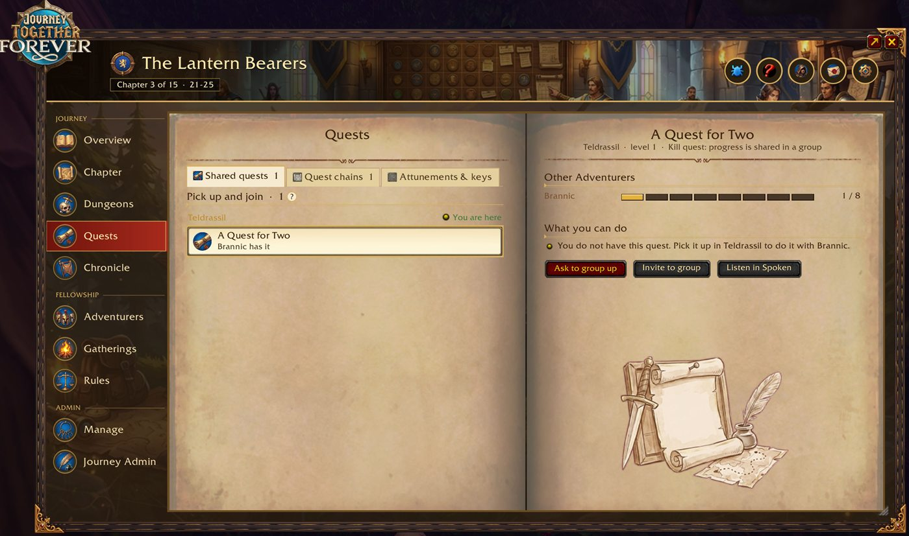

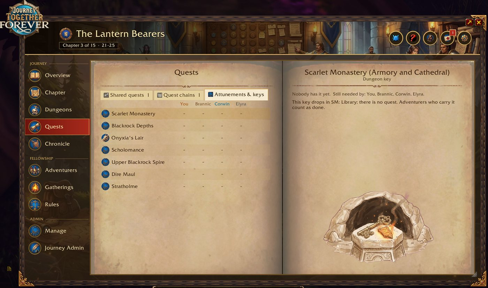

#### Gatherings
Plan times to play together: **Schedule** a Gathering with a time and a note, everyone answers Yes, Maybe or No, and
the page shows who is coming and the week ahead as seven day cards, like the game's calendar. A reminder pops up before it starts, and the Overview and the
tracker show the next one.

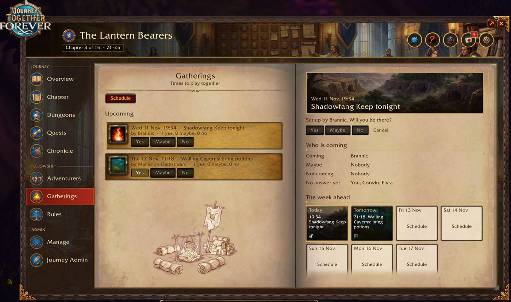

#### The Endgame and raids
When the last chapter is complete, **the Endgame** opens: WoW Forever's raids (Barrow Deeps, Hyjal Summit and
Onyxia's Lair, from 9 December 2026; more as Blizzard announces them), each with who is attuned, every boss with how many
Adventurers have killed it, and **Find group** for the raid. A raid not open yet shows its picture and a countdown
("Opens in 33 days").

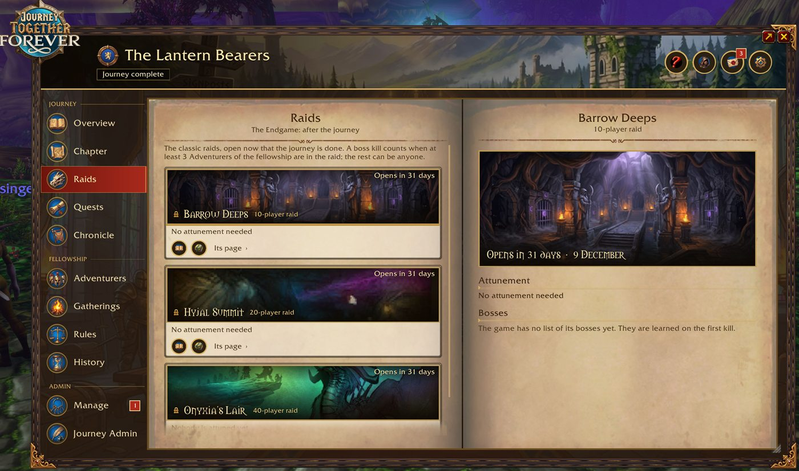

### Challenge modes
When creating the fellowship, the Leader can take on challenges. They combine, and can't be added later, so a run is
honest from level 1.
- **Survival**: **Hardcore Fellowship** (one life each; **Hardcore PvP Fellowship** on a PvP realm) and **Shared
  lives** (the fellowship's lives together, shown as candles).
- **Story and Travel**: **Lord of the Rings** (the first ring anyone finds is the Ring: carry it to Blackrock Mountain
  and destroy it there), **Walk everywhere**, **Questless** and **Race to 60** (your account keeps the best time).
- **Gear, Gold & More**: **Fellowship-found**, **Fellowship-crafted** (wear only gear someone in the fellowship
  made), **White gear only**, **Pauper** (you set the gold), **Ironman Fellowship**, **One class only**, **No healers**
  and **Dungeons only**.

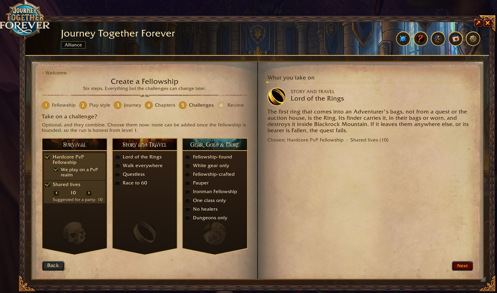

- The addon can't stop anyone, but it notices: a broken rule is written in the Chronicle and shown on that
  Adventurer's card, and they play on. One class only and No healers are held at the door.
- The rulebook has an article for the challenges: each with its rule, who broke it, the lives left, the Ring and the
  race clock, and tiles for where the challenges stand. The Leader can turn one off in Manage, for good.

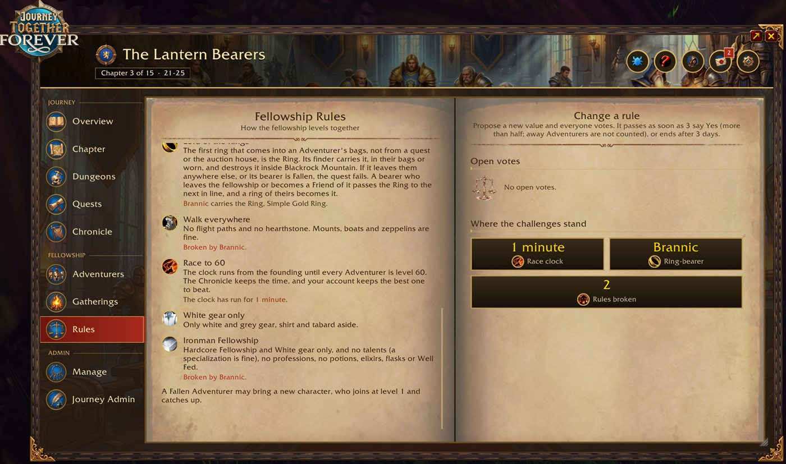

- **The Fallen**: an Adventurer whose last life is spent stays in the fellowship, honoured with a memorial page, and
  may bring a new character who starts at level 1. Each Adventurer can light a candle on the memorial once.

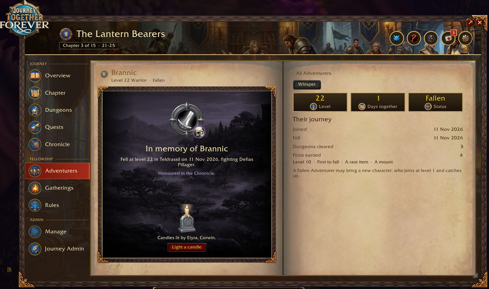

### Lead the fellowship

#### Create a fellowship
Five steps, and you can change everything later except the challenges:
1. **Fellowship**: the name, your role, how many you will be (Duo, Trio, Party, Large or any size; it picks the
   rules that fit) and the banner: a colour and an emblem from picture crests and 16 heraldic emblems.
2. **Play style**: Relaxed, Together or Strict, each shown as a strip of levels: below the floor, slack, floor to
   cap, fellowship runs only, over the cap. Or fine-tune every rule yourself.
3. **Journey**: Forever, Classic, Short chapters, Long chapters, or **your own journey** (one more step: the journey editor).
4. **Challenges**: none, or any of [the challenge modes](#challenge-modes), on three banners side by side.
5. **Review**: everything as rows, each with Change, then Create the fellowship.

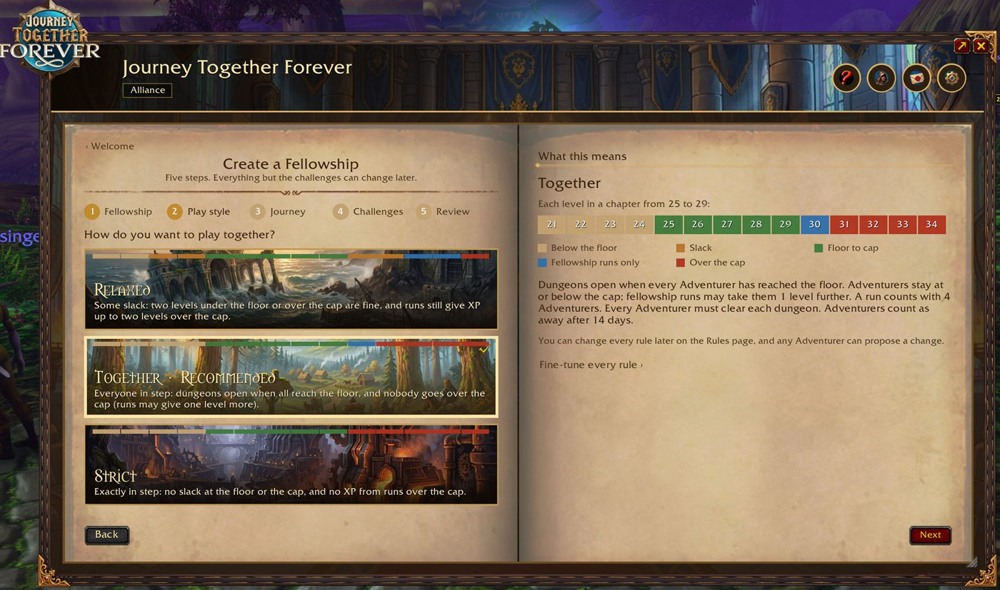

#### Shape the journey
**Journey Admin** (the Leader) is the journey editor, also used for your own journey while creating the fellowship:
- A **ruler** from 1 to 60 with every chapter in its colour. Drag a gold mark to move the level two chapters share;
  **Split in two**, **Merge with next** and **Remove** chapters.
- The right page has three tabs: **This chapter** (its name, levels, dungeons and milestones), **Every dungeon** and
  **Whole journey** (start over, Import, Export).
- Drag dungeons from **Every dungeon** (all of them by level, gold where it fits) onto a chapter. A dungeon can sit in
  more than one chapter (Blackrock Depths in three, for its parts).
- Each dungeon is Mandatory, Bridge or Optional, and you can choose **which bosses** a clear needs.
- **Milestones**, up to ten per chapter, Required or Optional: a quest everyone has handed in, a level everyone
  reaches, an attunement or key, or one the Leader ticks off by hand.
- **Export** the journey as a string to share with another fellowship, or **Import** one. Changes are a draft until
  you press **Publish**, in a bar at the bottom that never scrolls; everyone gets a toast.

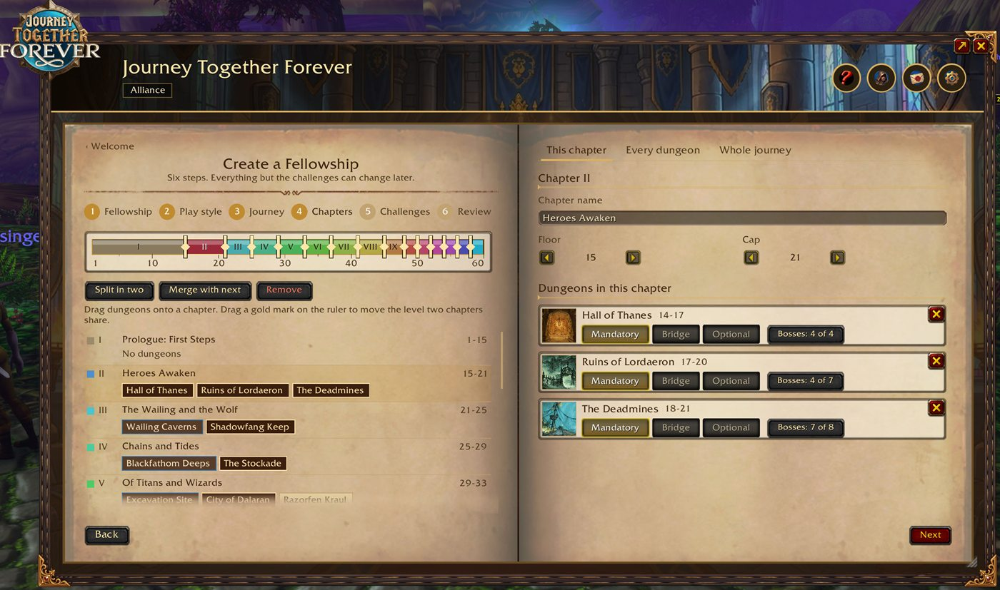

#### Manage the fellowship
The Leader's **Manage** page has three tabs:
- **Adventurers**: what needs the Leader's attention (each line with Their card and **Seen**), then every Adventurer
  with **Make leader**, **Mark away** and **Remove** (each asks first), and the invite box with the invites still
  waiting for an answer.
- **The fellowship**: its name and banner, as the Adventurers see it in the book, and leaving.
- **Rules**: the rules on a draft, then Publish in a bar at the foot of the page that never scrolls (see
  [the rulebook](#the-rulebook-and-votes)), and the challenges.

#### The rulebook and votes
- The **Rules** page is the fellowship's rulebook: six numbered articles in plain sentences, today's values in colour
  (Leveling together, Dungeon runs, Away, If the Leader is away, The book, Guild Master tournament).
- **Any Adventurer can propose a change**, and everyone votes Yes or No. It passes when more than half say Yes (away
  Adventurers are not counted), or ends after 3 days.
- The Leader sets the rules on a draft in **Manage** and publishes them; everyone gets a toast and a line in the
  History.
- The rules: floor and cap allowance, XP from fellowship runs past the cap, Adventurers needed for a run, how many
  must clear each dungeon, away after N days, takeover after N days, which chapters Adventurers can see, and the
  tournament.

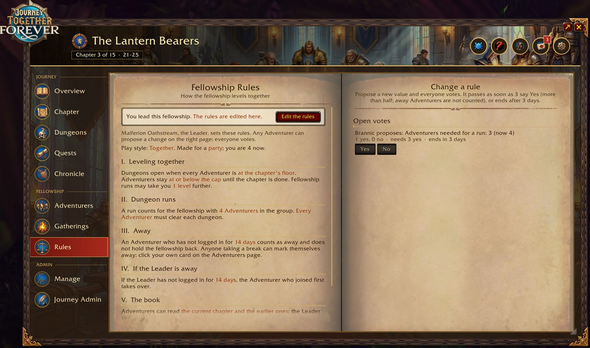

#### Guild Master tournament
An optional tournament when the whole fellowship is one guild: the winner becomes Guild Master. Sign-up, seeds by
level or random, and four formats: Bracket, Double elimination, Groups then bracket, and Round robin, with one duel,
best of 3 or best of 5. Duels are picked up from the game's own message ("X has defeated Y in a duel"); a duel not
fought before the round ends goes to whoever was online longer that round.

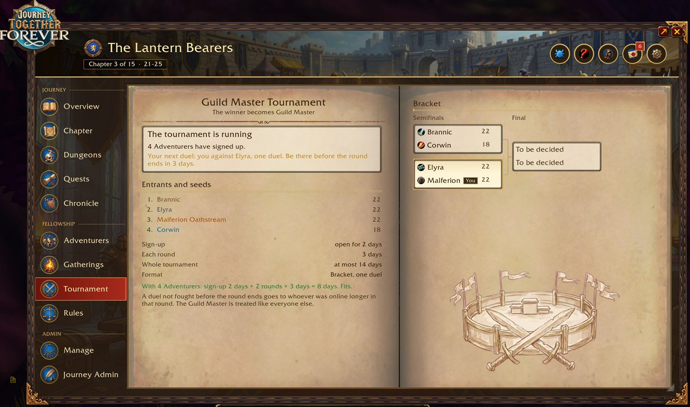

### Memories

#### Chronicle, Moments and History
- **Chronicle**: the journey's story. Every run, whether it counted and why not ("3 Adventurers, 4 needed"), leader
  changes, going over the cap, and **session recaps**: after playing together, how long, with whom, the levels, the
  dungeons, the bosses and the quests.
- **Firsts**: the first Adventurer to reach level 10, 20 ... 60, to fall, to wear a rare or an epic item, to ride a
  mount, to hold 100 gold, to bring a profession to 150, 225 or 300, and to win a PvP kill, as a cabinet of medals.
  Light-hearted tallies too: who has fallen most, run most dungeons and turned in most quests.
- **Moments**: the big moments, kept as they happened: a chapter begins, a dungeon is cleared for the first time, a
  milestone, a first, someone reaches 60, a champion is crowned. Each with its picture, **who was there** with their levels
  then, and how many screenshots you took.
- **History**: the fellowship's own story: founded, who joined and left, Leaders, rules and votes, Gatherings and the
  tournament.

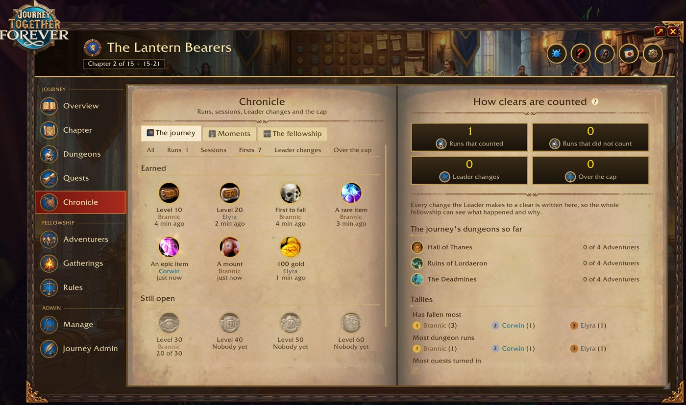

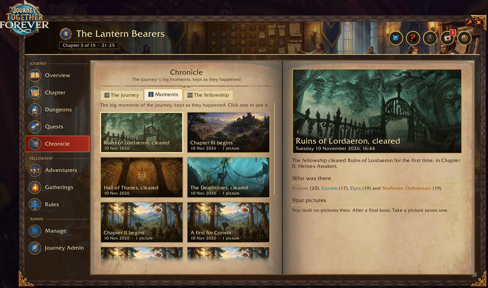

#### Group photo
The interface hides and the whole fellowship stands together in 3D on the whole screen, everyone at their true
size, up to six in a row and as many rows as needed. Choose a **pose** for everyone or one person (Cheer, Salute,
Bow, Dance and more), a **backdrop** (the world, a studio, the chapter's picture, the dungeon), names and a caption
with the crest. Over the world, **Look around** lets you walk and turn to find the place. **Take the photo** saves a
screenshot without the controls. The game can only draw Adventurers who are near you; the others are left out.

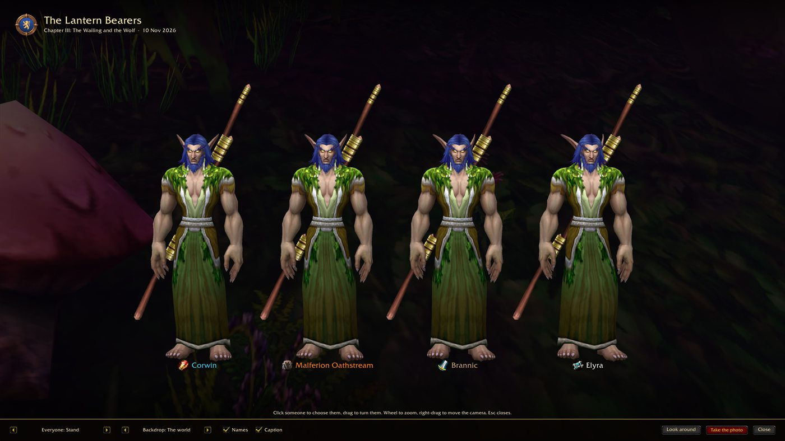

#### Discord
Post the fellowship's progress to your Discord channel through the separate app
[**WoW Addon Webhooks for Discord**](https://github.com/Vaderstrom/WoW-Addon-Webhooks-for-Discord) (download it from
[its releases](https://github.com/Vaderstrom/WoW-Addon-Webhooks-for-Discord/releases/latest); this addon's plugin is in
`Webhooks/`). It keeps a **board picture** of the fellowship up to date (the chapter, its
steps, every Adventurer, the dungeons, who you are waiting for, the latest news) and can post when a chapter is
complete, when a dungeon is cleared, the fellowship's firsts, and the pictures you took after a final boss. The addon writes its news when you
log out; the app reads it from your saved data and posts nothing you have not chosen.

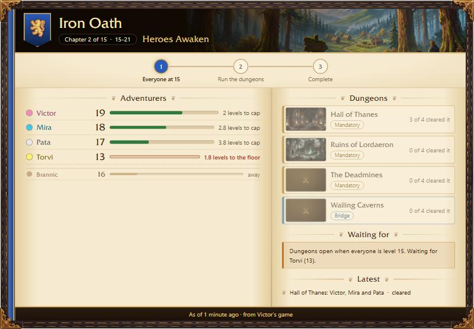

### On your screen

#### Toasts, the tracker and the picture moment
- **Toasts**: a banner when a chapter unlocks, everyone reaches the floor, a dungeon is cleared, an Adventurer
  reaches the floor or the cap or goes over it, new rules, a Gathering soon, an attunement opens, and more. Big
  moments (a chapter unlocked, the journey complete) show first in the middle of the screen, like the game's Level Up
  banner. Each can be turned off, and you can drag them where you like, or hold Ctrl and drag one while it shows.
  Click one to open the page it is about.
- **The tracker**: the chapter, where you stand (with a little bar to the floor or the cap and where to stop
  questing), the next step, dungeons cleared, who is online, the next Gathering, shared quests, your next duel and
  your inbox, each line with its icon. It starts as a panel you drag anywhere, which can hide until you point at it;
  or put it under the game's quest tracker, as one more section in the game's own look that moves and folds with the
  game's list. Hold Ctrl to drag it by any line, or out from under the game's list.
- **Picture after a final boss**: Take a picture (with or without the interface) or open the group photo, right
  there in the dungeon.
- The **inbox** in the header: invitations, votes, Gatherings, asks to group up, the tournament. A notice that asks
  no answer has a button to where it is handled, and **Seen** takes it off the count.

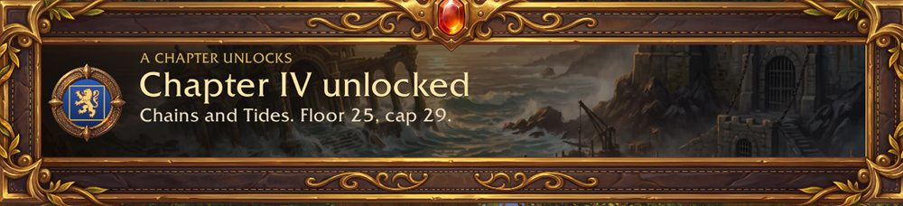

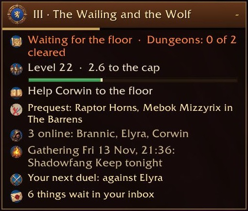

#### Look and settings
- The book: a leather book with parchment pages and art for every page, in the game's own look (its fonts, buttons
  and frames). Drag the corner to resize it (80% to 120%), or go **full screen**, edge to edge.
- **Themes**: Journal, Night, and Faction (Alliance blue or Horde red).
- A **setup guide** the first time (it asks where you want the tracker), then **Show me around**: a short first tour
  of the Overview, the sidebar, the buttons at the top and the tracker. After it, each page shows you around by itself
  the first time you open it. The whole tour is in Settings, and the **?** in the header walks you through the page
  you are on.
- Settings for every toast (under three headings, each with a tick for its whole group), the tracker's lines, chat
  messages, the cap warning, sounds, reduced effects and the minimap button. A **key** opens the book (Options →
  Keybindings → AddOns), at the page you choose. Button collectors can gather the minimap button, and the addon is in the game's addon compartment.
- **What's New**: once after an update, a page over the book with the update's news. `/jtf news` shows it again.

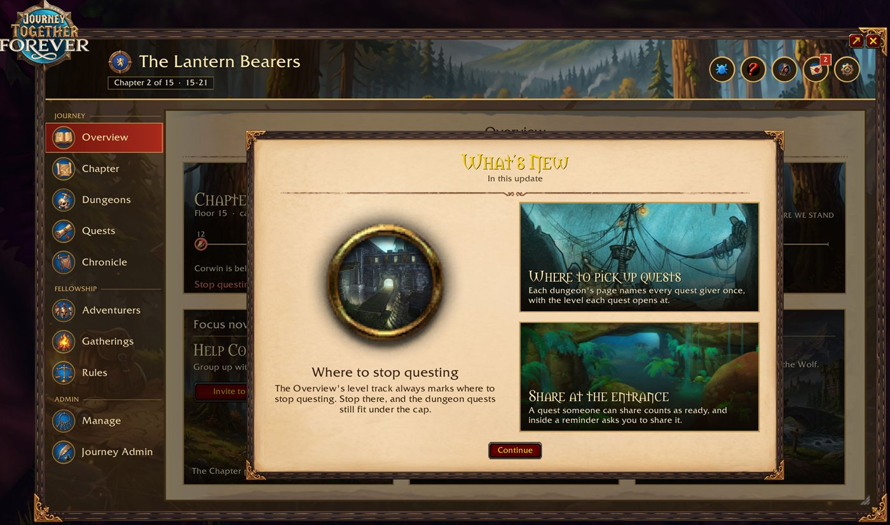

## Commands
- `/jtf`: open or close the book (or click the minimap button, or set a key: Options → Keybindings → AddOns)
- `/jtf chapter`, `/jtf heroes`, `/jtf quests`: open those pages
- `/jtf photo`: the group photo
- `/jtf news`: What's New
- `/jtf settings`: Settings

## Playing at different times
Adventurers' addons talk to each other with whispers in the background; nothing goes through a server. Every addon
keeps its own copy of the fellowship and catches up from the others when you log in, so changes made while you were
offline arrive once someone who has them is online. In dungeons and during boss fights the game holds addon messages;
they go out when you leave. Characters you have not played for a while show "as of" when you last did.

## Status
Journey Together Forever is released for WoW Forever. Every version is checked in WoW Forever with the addon's own
self-test and screenshot tour. Everyone in a fellowship should use the same version: the addon tells you when a newer one
is out.
Please report problems as GitHub issues, with a screenshot and the text of any Lua error (`/console scriptErrors 1`).
`CHANGELOG.md` lists what changed.

## Install
Install it with the [CurseForge app](https://www.curseforge.com/wow/addons/journey-together-forever), or download the
zip from the latest GitHub release and unpack it into `World of Warcraft/_forever_/Interface/AddOns/` (the folder must
be called `JourneyTogetherForever`). Restart the game fully after installing or updating, then type `/jtf`.

## License and credits
MIT License, see `LICENSE`. Copyright (c) 2026 Vaderstrom.

- Dungeon and boss data (`Data/Encounters.lua`) comes from the game's own data tables, via [wago.tools](https://wago.tools).
- Questie, Dungeon Journal, Attune, Spoken and Lore Forever are other people's addons. Journey Together Forever only opens
  them when you have them installed; none of their data is included.

Journey Together Forever is designed and developed by **Vaderstrom**. Claude, Anthropic's AI assistant, has assisted in
its development.
