# Journey Together Forever

Level together. Chapter by chapter.

A World of Warcraft addon for a group of friends who want to level from 1 to 60 together, without anyone running ahead
or falling behind. You create a **fellowship**, invite your Adventurers, and walk the road to 60 as a book of
**chapters**. Each chapter has a level floor, a level cap and the dungeons you clear as a group. When the chapter is
done, the next one opens for everyone.

Built for **WoW Forever**. Until Forever is out, it is developed and tested on the retail client.

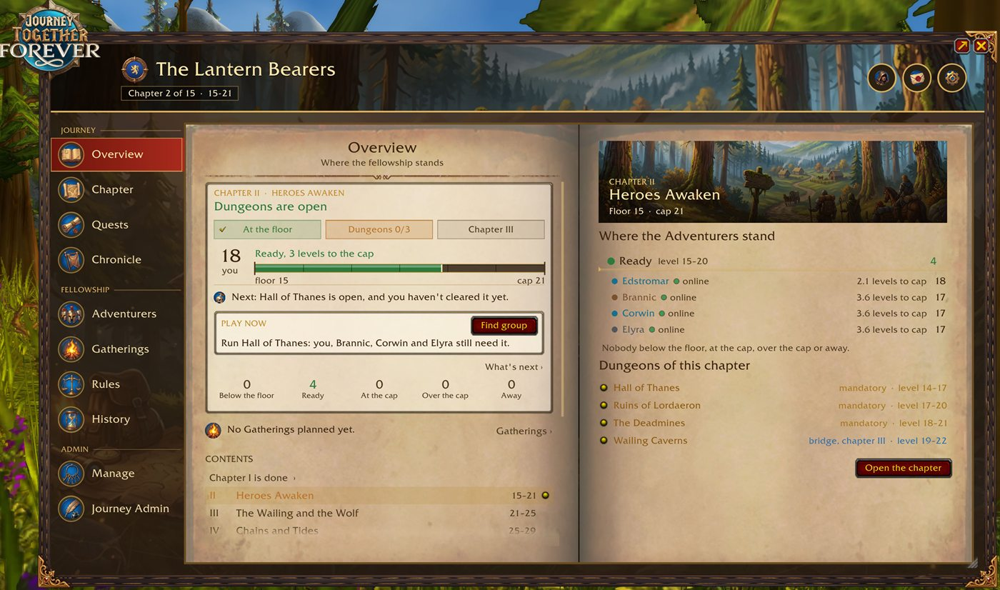

- [How it works](#how-it-works)
- [Features](#features): [creating a fellowship](#create-a-fellowship), [the journey](#shape-the-journey),
  [where you stand](#where-you-stand), [chapters and dungeons](#chapters-and-dungeons),
  [nobody left behind](#nobody-left-behind), [Adventurers](#the-adventurers), [quests](#quests-and-attunements),
  [rules and votes](#the-rulebook-and-votes), [Gatherings](#gatherings), [Chronicle and Moments](#chronicle-moments-and-history),
  [group photo](#group-photo), [toasts and tracker](#toasts-the-tracker-and-the-picture-moment),
  [raids](#the-endgame-and-raids), [tournament](#guild-master-tournament), [Discord](#discord), [look and settings](#look-and-settings)
- [Commands](#commands) · [Playing at different times](#playing-at-different-times) · [Status](#status-beta) ·
  [Install](#install) · [License and credits](#license-and-credits)

## How it works
- A **fellowship** is a group of characters of one faction, from any guild or none. It has two ranks: the **Leader**
  and the **Adventurers**. Joining is by invitation only.
- The **journey** is the road from level 1 to 60: a **Prologue** for levels 1-15, then chapters such as
  *Heroes Awaken, 15-21* or *The Wailing and the Wolf, 21-25*. The Classic journey has 15 chapters.
- Each chapter has a **floor** (the lowest level) and a **cap** (the highest). Its **dungeons open** when every
  Adventurer has reached the floor. The chapter is **complete** when its dungeons are cleared; a chapter without
  dungeons is complete when everyone has reached the cap. Then the next chapter opens for the whole fellowship.
- A dungeon is **cleared** for you once you were in the group for every boss that counts, in one run or over
  several. A boss kill counts when enough Adventurers of the fellowship are in the group (4 by default).
- Each dungeon in a chapter is **Mandatory**, a **Bridge** (it belongs to the next chapter but may be run now) or
  **Optional** (it never holds anyone back).
- Stay at or below the cap until the chapter is done. The rules say how strict that is, and fellowship runs may take
  you a level further.

## Features

### Create a fellowship
Four steps, and you can change everything later:
1. **Fellowship**: the name, your role, how many you will be (Duo, Trio, Party, Large or any size; it picks the
   rules that fit) and the banner: a colour and an emblem from picture crests and 16 heraldic emblems.
2. **Play style**: Relaxed, Together or Strict, each shown as a strip of levels: below the floor, slack, floor to
   cap, fellowship runs only, over the cap. Or fine-tune every rule yourself.
3. **Journey**: Classic, Short chapters, Long chapters, or **your own journey** (a fifth step: the journey editor).
4. **Review**: everything as rows, each with Change, then Create the fellowship.

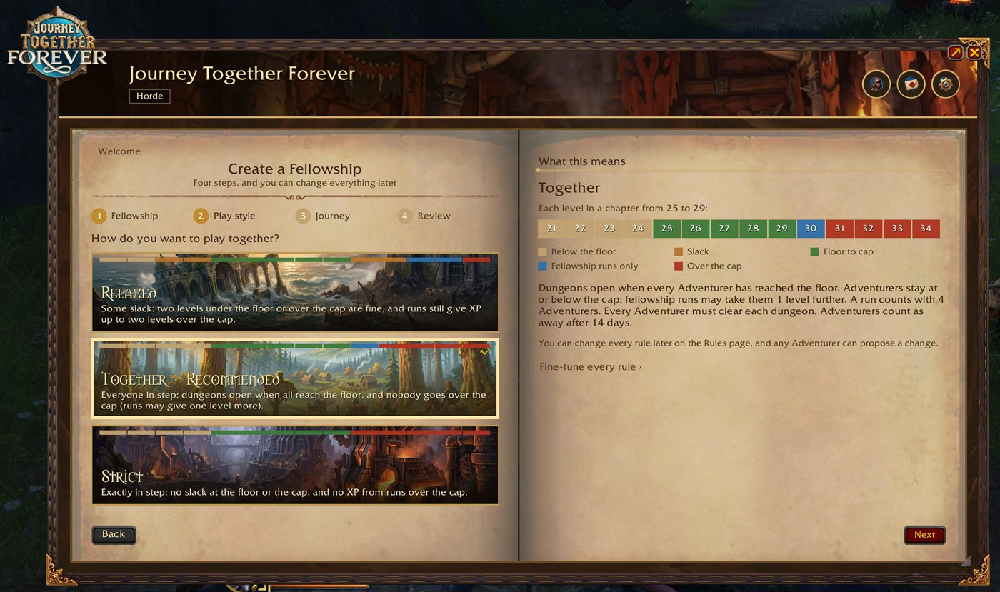

### Shape the journey
**Journey Admin** (the Leader) is the journey editor, also used for your own journey while creating the fellowship:
- A **ruler** from 1 to 60 with every chapter in its colour. Drag a gold mark to move the level two chapters share;
  **Split in two**, **Merge with next** and **Remove** chapters.
- The right page has three tabs: **This chapter** (its name, levels, dungeons and milestones), **Every dungeon** and
  **Whole journey** (start over, Import, Export).
- Drag dungeons from **Every dungeon** (all of them by level, gold where it fits) onto a chapter. A dungeon can sit in
  more than one chapter (Blackrock Depths in three, for its parts).
- Each dungeon is Mandatory, Bridge or Optional, and you can choose **which bosses** a clear needs.
- **Milestones**, up to ten per chapter, Required or Optional: a quest everyone has handed in, a level everyone
  reaches, an attunement or key, or one the Leader ticks off by hand.
- **Export** the journey as a string to share with another fellowship, or **Import** one. Changes are a draft until
  you press **Publish**, in a bar at the bottom that never scrolls; everyone gets a toast.

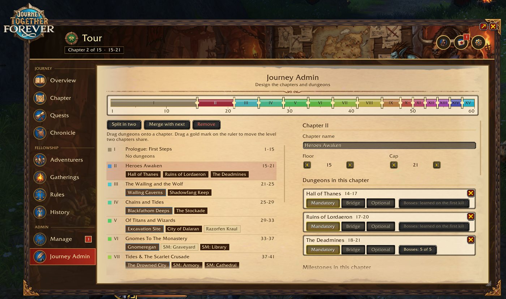

### Where you stand
The **Overview** answers "what now?" at a glance:
- **Where you stand**: the chapter's state ("Dungeons are open"), its three steps, your level on a line from the
  floor to the cap ("Ready, 3 levels to the cap"), your next steps, and the counts: below the floor, ready, at the
  cap, over the cap, away.
- **Play now**: the one best thing to do with whoever is online, with one button (Find group or Invite to group).
- **Where the Adventurers stand**, grouped the same way, and the chapter's dungeons.
- The **contents** of the whole journey (later chapters can stay hidden until reached), the next Gathering and the
  recent history.
- **Since you were last here**: what changed while you were away, who levelled, and where the fellowship stands now.

### Chapters and dungeons
- A **stage track** for the chapter: Everyone at the floor, Run the dungeons, Milestones, Complete. While someone is
  below the floor, a waiting box says who, how far, and about how long at their pace.
- Every dungeon as a row with its picture, role, levels and state ("4 of 7 bosses", "2 still need it"), with
  **Find group**, which invites the Adventurers online who still need it (a tank and a healer first).
- **Clears are picked up from boss kills** (no clicking needed). A toast tells everyone the moment the last needed
  boss dies; Adventurers outside the group hear it when the group leaves the instance.
- A **clears table** (Adventurer by dungeon). The Leader can mark a clear or undo one; undoing a clear an earlier
  chapter needs reopens that chapter, and the question says so first.
- Shortcuts to other addons when you have them: the **Dungeon Journal** addon (loot, quests, where to pick them up)
  and **Lore Forever** (the story of the place). Nothing of theirs is copied into this addon.

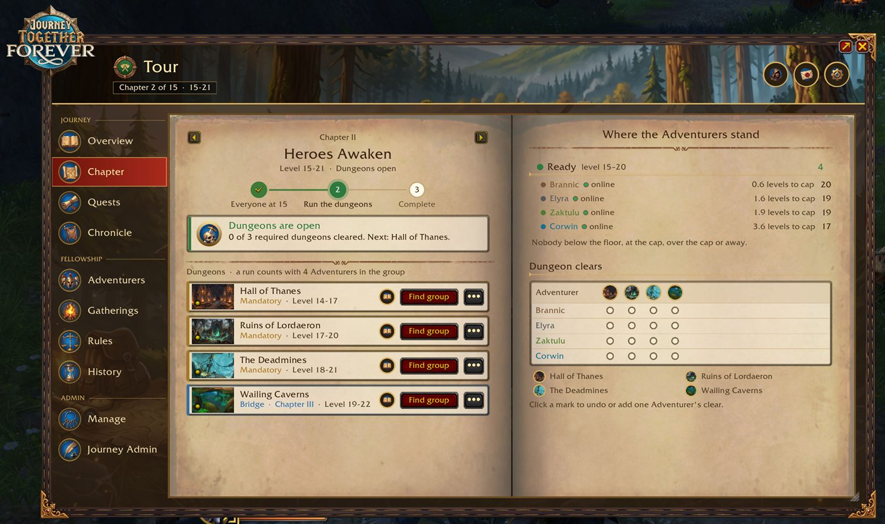

### Nobody left behind
- **Help runs**: a group with someone below the floor counts as a fellowship run.
- **Catching up**: someone who joins far below the current floor does not hold the fellowship back; they count
  like everyone once they reach the floor.
- **You pull ahead**: a toast when you are two or more levels above an Adventurer, and a **cap warning** in chat
  before you reach the cap (at a share of the last level you choose).
- Going over the cap is written to the Chronicle.
- **Away**: anyone can mark themselves away for a break, and an Adventurer not seen for 14 days (a rule) counts as
  away, so nobody waits for them.
- **If the Leader is away** for the rule's number of days, the Adventurer who joined first takes over.

### The Adventurers
- Every Adventurer with role, class, level, XP and rested XP, and a **presence mark** like the game's friends list:
  Online, AFK, Offline ("Seen 3 hours ago") or Away. A ring shows someone the game says is online whose addon does
  not answer.
- **3D heads**: yours always; another Adventurer's once you have been grouped and near (the game only draws players
  it has seen). Before that, their class crest.
- **Inspect**: their gear around the character in 3D, item level, XP, this chapter's dungeons, roles, Whisper and
  Invite to group.
- **Invite Adventurers**: everyone can invite; the name box suggests friends, Battle.net friends and guild members.
  A friend without the addon? **Share it** gives you the addon's page to whisper them.
- **Roles** and a secondary role, **I'm away**, and the fellowship's make-up (tanks, healers, damage).
- **Old addon**: everyone sees who runs an older version, and you get one reminder per session when it is you.
- **Your characters**: every character on your account with its fellowship, "as of" when you last played it.
  **Follow** another character's fellowship live while you play an alt, and **take that character's place** in the
  fellowship with the same rank and roles.

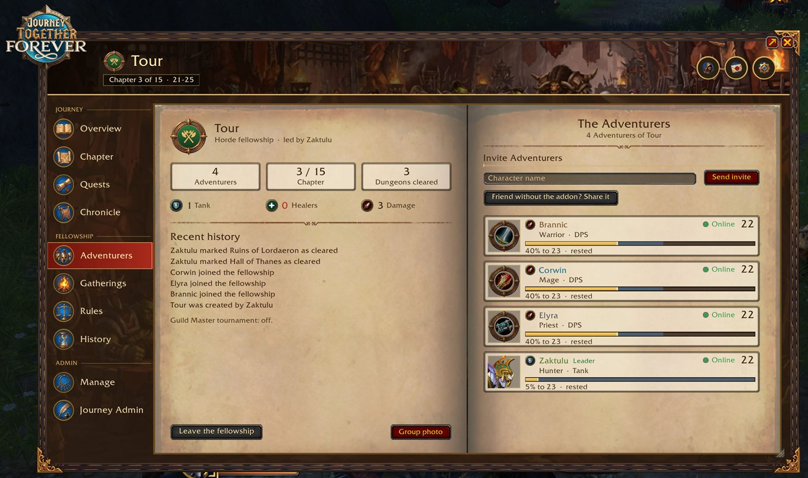

### Quests and attunements
- **Shared quests**: quests you and other Adventurers have (**Together**) and quests they have that you could pick
  up (**You could join**), with everyone's progress and what you can do: **Ask to group up**, Invite to group, or
  the game's **Share quest**.
- **Quest chains** learned as the fellowship plays, or all of them from the start with Questie installed.
- **Attunements and keys** up to 60 (Molten Core, Onyxia, Blackwing Lair, Upper Blackrock Spire, Scholomance,
  Blackrock Depths, Stratholme, Dire Maul and more): a grid of who has done what, and each one's steps.
- Dungeon quests: how many of each dungeon's quests every Adventurer has picked up.

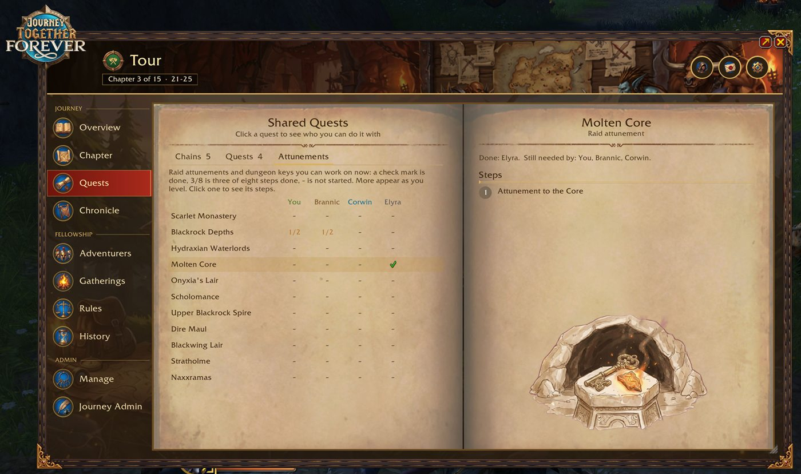

### The rulebook and votes
- The **Rules** page is the fellowship's rulebook: six numbered articles in plain sentences, today's values in colour
  (Leveling together, Dungeon runs, Away, If the Leader is away, The book, Guild Master tournament).
- **Any Adventurer can propose a change**, and everyone votes Yes or No. It passes when more than half say Yes (away
  Adventurers are not counted), or ends after 3 days.
- The Leader sets the rules on a draft in **Manage** and publishes them; everyone gets a toast and a line in the
  History.
- The rules: floor and cap allowance, XP from fellowship runs past the cap, Adventurers needed for a run, how many
  must clear each dungeon, away after N days, takeover after N days, which chapters Adventurers can see, and the
  tournament.

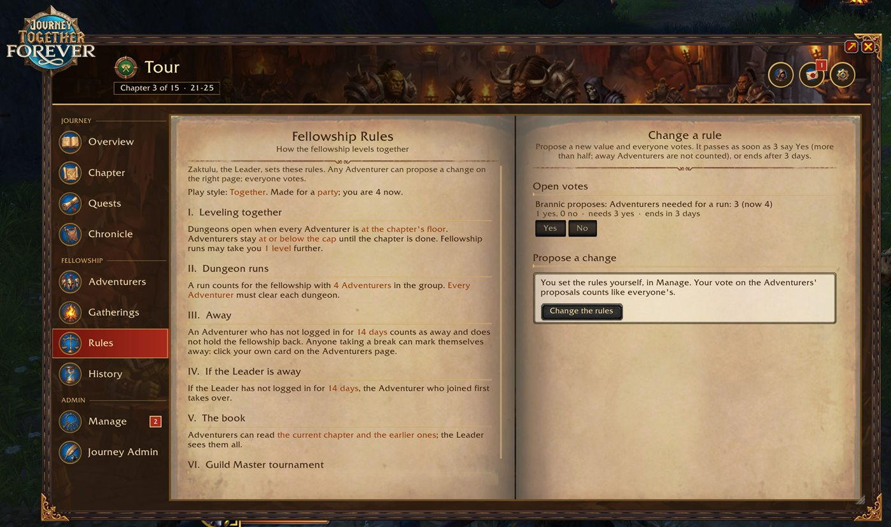

### Gatherings
Plan times to play together: **Schedule** a Gathering with a time and a note, everyone answers Yes, Maybe or No, and
the page shows who is coming and the week ahead. A reminder pops up before it starts, and the Overview and the
tracker show the next one.

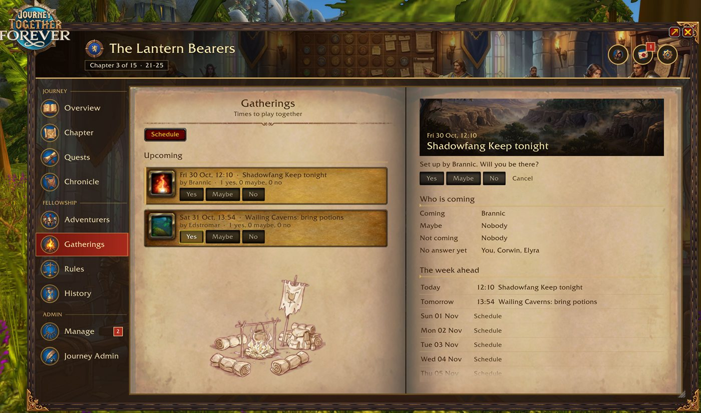

### Chronicle, Moments and History
- **Chronicle**: the journey's story. Every run, whether it counted and why not ("3 Adventurers, 4 needed"), leader
  changes, going over the cap, and **session recaps**: after playing together, how long, with whom, the levels, the
  dungeons, the bosses and the quests.
- **Moments**: the big moments, kept as they happened: a chapter begins, a dungeon is cleared for the first time, a
  milestone, someone reaches 60, a champion is crowned. Each with its picture, **who was there** with their levels
  then, and how many screenshots you took.
- **History**: the fellowship's own story: founded, who joined and left, Leaders, rules and votes, Gatherings and the
  tournament.

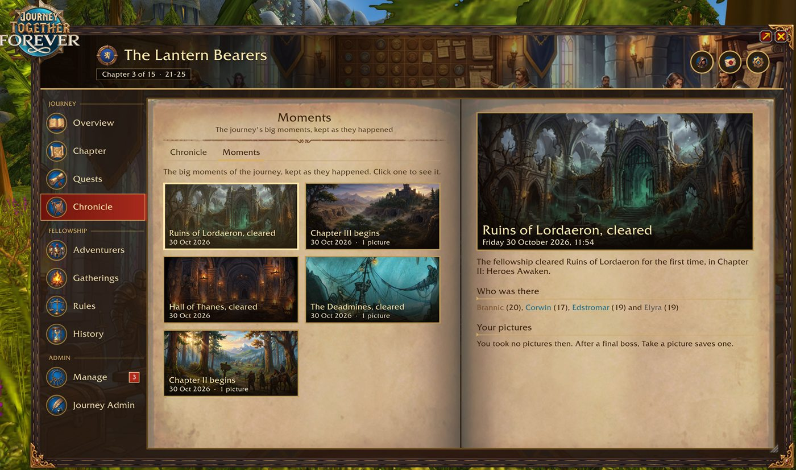

### Group photo
The interface hides and the whole fellowship stands together in 3D on the whole screen, everyone at their true
size, up to six in a row and as many rows as needed. Choose a **pose** for everyone or one person (Cheer, Salute,
Bow, Dance and more), a **backdrop** (the world, a studio, the chapter's picture, the dungeon), names and a caption
with the crest. Over the world, **Look around** lets you walk and turn to find the place. **Take the photo** saves a
screenshot without the controls. The game can only draw Adventurers who are in your group and near you; the others
are left out with a line that says so.

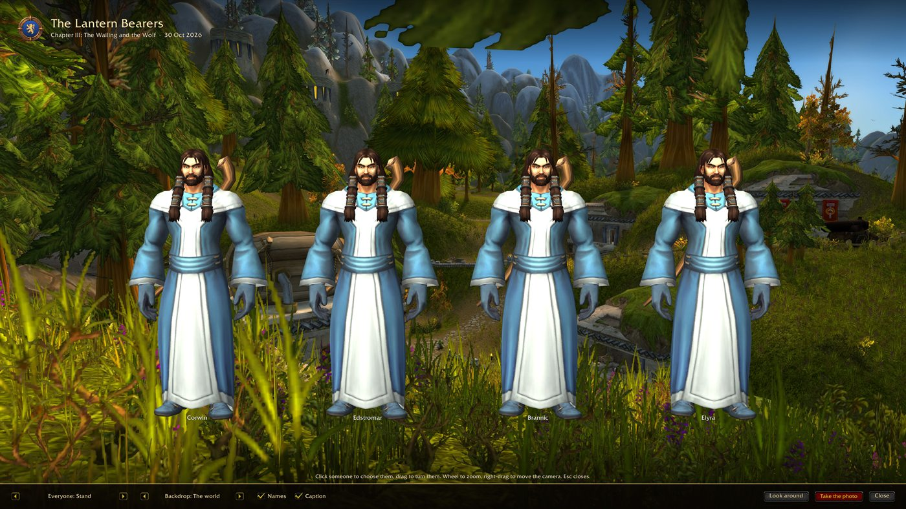

### Toasts, the tracker and the picture moment
- **Toasts**: a banner when a chapter unlocks, everyone reaches the floor, a dungeon is cleared, an Adventurer
  reaches the floor or the cap or goes over it, new rules, a Gathering soon, an attunement opens, and more. Big
  moments get a big banner. Each can be turned off, and you can drag them where you like. Click one to open the page
  it is about.
- **The tracker** on the screen: the chapter, where you stand, the next step, dungeons cleared, who is online, the
  next Gathering, shared quests, your next duel and your inbox; it can hide until you point at it.
- **Picture after a final boss**: Take a picture (with or without the interface) or open the group photo, right
  there in the dungeon.
- The **inbox** in the header: invitations, votes, Gatherings, asks to group up, the tournament.

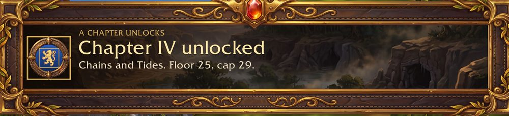

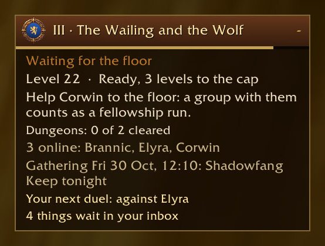

### The Endgame and raids
When the last chapter is complete, **the Endgame** opens: the classic raids (Zul'Gurub, Onyxia's Lair, Molten Core,
Blackwing Lair, Ruins and Temple of Ahn'Qiraj, Naxxramas), each with who is attuned, every boss with how many
Adventurers have killed it, and **Find group** for the raid.

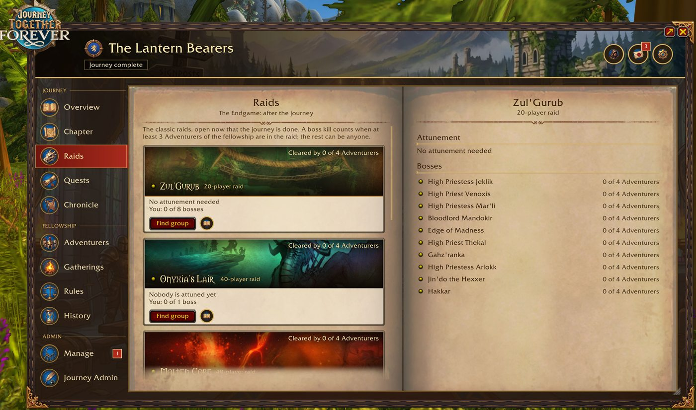

### Guild Master tournament
An optional tournament when the whole fellowship is one guild: the winner becomes Guild Master. Sign-up, seeds by
level or random, and four formats: Bracket, Double elimination, Groups then bracket, and Round robin, with one duel,
best of 3 or best of 5. Duels are picked up from the game's own message ("X has defeated Y in a duel"); a duel not
fought before the round ends goes to whoever was online longer that round.

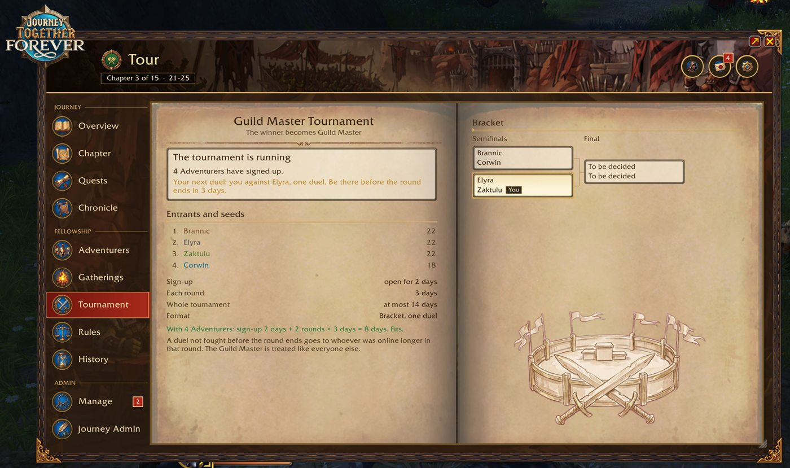

### Discord
Post the fellowship's progress to your Discord channel through the separate app
[**WoW Addon Webhooks for Discord**](https://github.com/Vaderstrom/WoW-Addon-Webhooks-for-Discord) (download it from
[its releases](https://github.com/Vaderstrom/WoW-Addon-Webhooks-for-Discord/releases/latest); this addon's plugin is in
`Webhooks/`). It keeps a **board picture** of the fellowship up to date (the chapter, its
steps, every Adventurer, the dungeons, who you are waiting for, the latest news) and can post when a chapter is
complete, when a dungeon is cleared, and the pictures you took after a final boss. The addon writes its news when you
log out; the app reads it from your saved data and posts nothing you have not chosen.

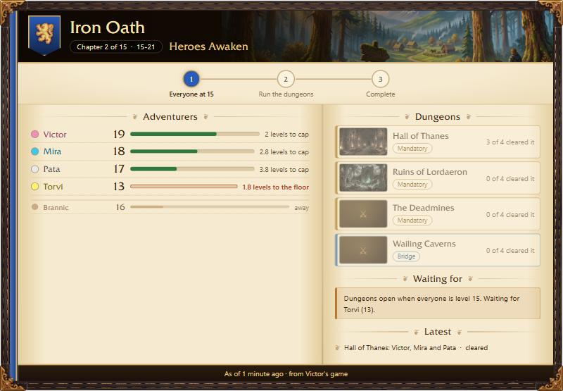

### Look and settings
- The book: a leather book with parchment pages and art for every page, in the game's own look (its fonts, buttons
  and frames). Drag the corner to resize it (80% to 120%), or go **full screen**, edge to edge.
- **Themes**: Journal, Night, and Faction (Alliance blue or Horde red).
- A **setup guide** the first time, and **Show me around**: a two-minute walkthrough of the book on a sample
  fellowship, for your rank.
- Settings for every toast, the tracker's lines, chat messages, the cap warning, sounds, reduced effects and the
  minimap button.

## Commands
- `/jtf`: open or close the book (or click the minimap button)
- `/jtf chapter`, `/jtf heroes`, `/jtf quests`: open those pages
- `/jtf photo`: the group photo
- `/jtf settings`: Settings

## Playing at different times
Adventurers' addons talk to each other with whispers in the background; nothing goes through a server. Every addon
keeps its own copy of the fellowship and catches up from the others when you log in, so changes made while you were
offline arrive once someone who has them is online. In dungeons and during boss fights the game holds addon messages;
they go out when you leave. Characters you have not played for a while show "as of" when you last did.

## Status: beta
This is a beta (0.9.2). Version 1.0 comes when WoW Forever launches: the addon will be tested there, and its
dungeon and raid lists brought in line with Forever's.

Everything above is built and checked with the addon's own self-test and screenshot tour on retail, with one account.
Tests with two or more real accounts are still to come. Everyone in a fellowship should use the same version.
Please report problems as GitHub issues, with a screenshot and the text of any Lua error (`/console scriptErrors 1`).
`CHANGELOG.md` lists what changed.

## Install
Download the zip from the latest GitHub release and unpack it into
`World of Warcraft/_retail_/Interface/AddOns/` (the folder must be called `JourneyTogetherForever`). Restart the game
fully after installing or updating, then type `/jtf`.

## License and credits
MIT License, see `LICENSE`. Copyright (c) 2026 Vaderstrom.

- Dungeon and boss data (`Data/Encounters.lua`) comes from the game's own data tables, via [wago.tools](https://wago.tools).
- Questie, Dungeon Journal, Attune and Lore Forever are other people's addons. Journey Together Forever only opens
  them when you have them installed; none of their data is included.

Journey Together Forever is designed and developed by **Vaderstrom**. Claude, Anthropic's AI assistant, has assisted in
its development.
